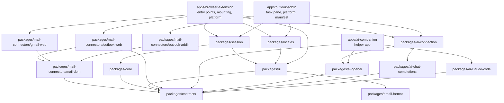

# Development guide

This guide is for contributors working on the Writehand extension and helper app. Related documents:

- [Helper app](./HELPER_APP.md): commands, connection methods, stored data and troubleshooting
- [Releasing](./RELEASING.md): versioning, signed releases, store submission and store assets
- [Manual testing](./MANUAL_TESTING.md): release checklist for clean machines
- [Building from source](./BUILD.md): reproducing the store packages
- [Contributing](../CONTRIBUTING.md): pull request conventions

## Requirements

| Tool | Version | Notes |
| --- | --- | --- |
| Node.js | 22 or newer | Node.js 24 LTS is required to build the single-file helper app (`pnpm ai:sea`) and is what CI uses |
| pnpm | 12.x | Pinned in `package.json` → `packageManager`. Install with `npm install -g pnpm@12` or `corepack enable` |
| Firefox | 140 or newer | Minimum version in the manifest (built-in data collection declaration) |
| Chrome, Edge, Brave | Current release | No minimum version is declared |

## Setup

```sh
pnpm install                          # dependencies and WXT type generation (postinstall)
pnpm exec playwright install chromium # once, only for the browser tests
```

## Commands

All commands run from the repository root.

| Command | What it does |
| --- | --- |
| `pnpm dev` | Chromium development build; opens a browser with the extension and reloads on change |
| `pnpm dev:firefox` | The same for Firefox (Manifest V3) |
| `pnpm build` | Helper app as a Node.js script, then production extension builds in `apps/browser-extension/.output/chrome-mv3` and `firefox-mv3` |
| `pnpm build:test` | Test builds (`chrome-mv3-test`, `firefox-mv3-test`) with the local fixture origin and labeled sample results instead of the AI connection |
| `pnpm ai:build` | Helper app as one Node.js script (`apps/ai-companion/dist/cli.mjs`) |
| `pnpm ai:install [--extension-id=ID]` | Installs that script as a development helper for all browsers (`cli.mjs install --dev`); see [Helper app](./HELPER_APP.md#development-install) |
| `pnpm ai:sea` | Single-file helper app and its release archive in `apps/ai-companion/dist/release/` (`writehand-<os>-<arch>.*`); run with Node.js 24 on the target system |
| `pnpm typecheck` | TypeScript and vue-tsc for every package and the tests |
| `pnpm lint` | ESLint: correctness and [module boundary](#module-boundaries) rules |
| `pnpm format` / `pnpm format:check` | Prettier (Markdown is excluded in `.prettierignore`) |
| `pnpm test` / `pnpm test:watch` | Vitest: unit, connector contract, Outlook and Gmail connectors, shared connector parts, Vue and controller tests |
| `pnpm test:e2e` | Test build, then Playwright with Chromium on the synthetic Outlook and Gmail pages |
| `pnpm test:firefox` | Test build, then a headless Firefox smoke test over WebDriver BiDi |
| `pnpm lint:firefox` | Production build, then Mozilla's `web-ext lint` on the Firefox package |
| `pnpm verify:packages` | Checks the production packages: permissions (including the optional provider origins), content script matches, no development code or local origins, Firefox ID and data collection declaration |
| `pnpm outlook:firefox [--restart] [--sign-in]` | Starts Firefox with a persistent profile and WebDriver BiDi for live Outlook inspection; `--sign-in` opens the profile without remote control, for signing in |
| `pnpm gmail:firefox [--restart] [--sign-in]` | The same window, opening Gmail |
| `pnpm outlook:dev [--restart]` / `pnpm gmail:dev` | Runs the extension with live reload in that Firefox window |
| `pnpm outlook:inspect <command>` | Runs the extension's reading code on the live Outlook page with masked output; see [Live inspection](#live-inspection) |
| `pnpm gmail:inspect <command>` | The same, read-only, on a live Gmail tab in that Firefox window; see [Live inspection](#live-inspection) |
| `pnpm release:version <x.y.z>` | Sets the version in the root `package.json` and opens its section in `CHANGELOG.md`; see [Releasing](./RELEASING.md) |
| `pnpm store:assets [icons] [addin-icons] [screenshots] [promo] [video]` | Generates icons (`addin-icons`: only the Outlook add-in's), store screenshots, promo images and the demo video in `store/`; see [Store assets](./RELEASING.md#store-assets) |
| `pnpm addin:dev`, `addin:build`, `addin:build:local`, `addin:serve`, `addin:certs`, `addin:validate` | The Outlook add-in's task pane; see [Outlook add-in](./OUTLOOK_ADDIN.md#development-on-windows) |
| `pnpm verify:addin` | Checks the add-in's production build: the pages' Content Security Policy, Office.js as the only remote script, no development code, and the manifest's ID, version, origin and permission when one was written |
| `pnpm check` | `typecheck`, `lint`, `format:check`, `test`, `build` (the extension, the helper app and the add-in), `verify:packages` and `verify:addin`; CI runs it on Linux, macOS and Windows |

To build a single package: `pnpm --filter @writehand/browser-extension exec wxt build -b firefox --mv3`. Store archives: `pnpm --filter @writehand/browser-extension zip:all`.

### Build modes

| Mode | Built by | AI connection | Local origins |
| --- | --- | --- | --- |
| `production` | `pnpm build`, `zip:all` | Helper app | No |
| `development` | `pnpm dev`, `pnpm dev:firefox`, `pnpm outlook:dev` | Helper app | `localhost` and `127.0.0.1` under `/mail/` (Outlook script) and `/gmail/` (Gmail script); the popup shows selector diagnostics (match counts only) |
| `test` | `pnpm build:test` | Labeled sample results (`src/development/fixture-results.ts`) | Yes |
| `demo` | `pnpm store:assets` (`wxt build --mode demo`) | Helper app (a fake helper in the asset scripts) | Yes |

Only the test build produces sample results. Do not use it to try real generation.

## Loading the extension manually

- **Chrome, Edge, Brave:** open `chrome://extensions` (`edge://extensions`, `brave://extensions`), turn on Developer mode, select **Load unpacked** and choose `apps/browser-extension/.output/chrome-mv3` (or `chrome-mv3-test`).
- **Firefox:** open `about:debugging#/runtime/this-firefox`, select **Load Temporary Add-on** and choose `apps/browser-extension/.output/firefox-mv3/manifest.json`.

Things to know:

- `pnpm dev` starts with a fresh temporary profile every time. To develop against a real Outlook account, use `pnpm outlook:dev`: you sign in to Outlook once in a persistent profile and the extension is loaded into that window on every run.
- An unpacked Chromium extension gets its ID from the folder path, so `chrome-mv3`, `chrome-mv3-dev` and `chrome-mv3-test` have different IDs, and the IDs differ between machines and operating systems. Register the helper app for the ID you use: `pnpm ai:install --extension-id=ID`. Firefox uses the fixed ID `writehand@dervisgenc.com` in every build.
- Chrome 137 and later ignore the `--load-extension` command line flag; load unpacked builds from `chrome://extensions`. To automate Chrome itself, use Playwright's `launchPersistentContext` with Chrome's executable, `--enable-unsafe-extension-debugging` and the CDP command `Extensions.loadUnpacked`. The Playwright tests are unaffected because they use Chromium; Edge and Brave still accept the flag.

## Windows notes

`pnpm check`, `pnpm test:e2e` and `pnpm test:firefox` run on Windows 11 as on macOS and Linux.

- **Setup:** install Node.js 22+ and Git for Windows. `corepack enable` needs administrator rights because it writes to `Program Files\nodejs`; use `npm install -g pnpm@12` instead.
- **Shell:** commands are the same in PowerShell and Git Bash. Windows PowerShell 5.1 may show lines that pnpm writes to stderr as red `NativeCommandError`; the exit code is what counts.
- **Line endings:** `.gitattributes` checks out every text file with LF; no `core.autocrlf` setting is needed.
- **Tests:** a few unit tests run only on macOS and Linux (executable permission, the `sh` launcher, the update flow with a real `tar`) and are skipped on Windows. Windows-only tests cover the ACL of the credentials folder and starting the development `.cmd` launcher through `cmd.exe` from a folder whose name contains non-ASCII characters, spaces, `&` and `%`. The install plan of every operating system is tested on every machine (`tests/unit/ai-companion-install.test.ts`); installing, removing and the registry entries of the single-file program are exercised on the Windows CI runner.
- **Firefox tests:** Firefox is looked up as `Mozilla Firefox\firefox.exe` under `%ProgramFiles%`, `%ProgramFiles(x86)%` and `%LOCALAPPDATA%`, not on `PATH`; set `FIREFOX_BIN` to override. A test profile's Firefox is closed through PowerShell (`Get-CimInstance`) instead of `pkill`.
- **Windows tools:** the helper app calls `reg`, `icacls`, `whoami`, `rundll32`, `tar` and `powershell` by their full path under `%SystemRoot%\System32`. Git Bash, for example, puts its own `whoami` first on `PATH`.
- **Batch files:** `cmd.exe` reads `.cmd` files in the console code page (for example 437), so the development launcher is written as UTF-8 and starts with `chcp 65001 >nul`. A release install has no launcher; the manifest points to `writehand.exe`.
- **Registry:** after installing, `reg query "HKCU\Software\Google\Chrome\NativeMessagingHosts\com.dervisgenc.writehand"` should show the manifest path. The keys for each browser are listed in [Helper app](./HELPER_APP.md#windows).

## Architecture

### Packages and apps



`ai-connection` imports only the browser-safe part of `ai-openai` (`@writehand/ai-openai/api-key`: the Responses API, without OAuth or Node.js code).

| Package | Responsibility | Must not use (enforced by ESLint) |
| --- | --- | --- |
| `contracts` | Shared types, the `MailConnector` and `TextProcessor` interfaces, Zod boundary schemas (settings, runtime messages, the host protocol, previews), error codes, brand and external IDs, API key providers and their permissions, the AI prompt | Vue, WXT, browser or DOM globals, other internal packages |
| `core` | `buildContext`, `prepareAction`, `reduceSession`, apply and undo validation, capabilities. Pure functions; clock and ID generator are passed in | Vue, WXT, Zod, browser globals, `ui`, `outlook-web` |
| `ui` | Vue panel, toolbar, result card, settings and setup components. Receives read-only view data and emits events; all text comes from the locale dictionaries | WXT, `core`, `outlook-web`, `chrome`, `browser`, `document`, `navigator`, web storage |
| `outlook-web` | Outlook on the web: page detection, the active conversation, reading messages, finding draft editors, theme. Every selector lives in `src/discovery/selectors.ts` | Vue, WXT, `core`, `ui`, other connectors, extension APIs, `window`, web storage |
| `gmail-web` | Gmail on the web: page detection, the open conversation, reading messages, finding draft editors (inline replies, compose windows), theme. Every selector lives in `src/discovery/selectors.ts` | Vue, WXT, `core`, `ui`, other connectors, extension APIs, `window`, web storage |
| `outlook-addin` | The Outlook add-in's connector over Office.js: the open item (a received message or a draft), body anatomy from the HTML Office.js returns (parsed into a detached document and read with `mail-dom`), selection capture, controlled writes and their verification, undo for a new message's body, a new reply in read mode, `ItemChanged`. The real Office.js adapter is `src/office/office-mailbox.ts`; everything else works against the `OfficeMailbox` port | Vue, WXT, `core`, `ui`, other connectors, extension APIs, `window`, web storage; `Office` outside `src/office/` |
| `mail-dom` | What every mail connector shares: text extraction, draft tracking (`createComposerRegistry`), selection capture, controlled writes, verification and undo, editor and page observation, opaque identities, and the quote and signature markers of email HTML (`mail-markup.ts`) | Vue, WXT, `core`, `ui`, the connectors, extension APIs, `window`, web storage |
| `session` | The panel session both apps share: the action, apply and panel controllers, the opened-message history, the session store, the panel view model, the Vue bridge (`usePanelSession`), the appearance resolver, the settings store over `StorageArea`, and the system clock and IDs | WXT, browser and page globals, `fetch`, `Office`, `ai-connection`, `locales`, `mail-dom`, the connectors, the AI provider packages |
| `ai-connection` | The API key method: the encrypted key vault (`createSecretVault`, `createIndexedDbKeyStore`), the connection choices (`createAiConnectionStore`), the Groq, OpenRouter and OpenAI providers and `createApiKeyConnection` | Vue, WXT, browser page globals, `Office`, Node.js modules, `core`, `ui`, `session`, `locales`, `mail-dom`, the connectors |
| `locales` | The user-facing text in the five interface languages, `textFor`, `uiLanguageFor`, `countWith` and the manifest messages | Vue, WXT, browser page globals, every internal package except `contracts` and `ui` (types) |
| `email-format` | Parses the model's limited Markdown and produces email-safe HTML, plain text and the text used to verify a write (pure functions) | Vue, WXT, browser globals, other internal packages (Zod only) |
| `ai-openai` | ChatGPT OAuth (PKCE, OIDC), model discovery, Responses API streaming, stable error codes; `api-key.ts` is the browser-safe entry for OpenAI API keys | Browser globals, UI or mailbox packages, the other provider packages; in the browser-safe files also Node.js modules and `jose` |
| `ai-chat-completions` | Groq and OpenRouter: OpenAI-compatible Chat Completions streaming, model lists, free default models, stable error codes. Runs in the browser and in Node.js | Browser page globals, Node.js modules, UI or mailbox packages, the other provider packages |
| `ai-claude-code` | Finds the user's Claude Code, reads its sign-in status and runs it in restricted print mode | Browser globals, UI or mailbox packages, the other provider package |
| `apps/ai-companion` | The helper app: native messaging host, loopback sign-in, credential store, installer, updater. OS differences live only in `src/platform.ts` | Browser globals, UI or mailbox packages; `process.platform` and `process.arch` outside `platform.ts` |
| `apps/browser-extension` | Wires the parts together (`src/bootstrap/create-extension-session.ts`); browser APIs only in `src/platform/` and the entry points. The helper app's methods (`src/platform/ai-connection.ts`, `helper-client.ts`, native messaging) stay here | `chrome` and `browser` globals in `composables`, `mounting`, `bootstrap`, `development` |
| `apps/outlook-addin` | The Outlook add-in's task pane (Vite and Vue): `src/bootstrap/create-addin-session.ts` wires the session, the connector and the API key service in one page; `src/platform/` holds Office.js (`office-host.ts`), storage and the clipboard; `build/` generates the manifest and the Content Security Policy. See [Outlook add-in](./OUTLOOK_ADDIN.md) | `Office` outside `src/platform/`; `chrome`, `browser` |

Dependencies are passed as function parameters. There is no dependency injection library, plugin loader or global event bus.

### Runtime contexts

| Context | Location | Role |
| --- | --- | --- |
| Content scripts | `entrypoints/outlook.content.ts`, `entrypoints/gmail.content.ts` | One per mail service: its connector, the panel session, toolbar and launchers (`src/bootstrap/start-mail-session.ts`). Email session and AI previews live in memory only |
| Background | `entrypoints/background.ts` | Install events, settings reads and writes, the AI connection: the API key method itself (vault, provider requests) and the helper app's methods over native messaging. Service worker in Chromium, background script in Firefox |
| Popup | `entrypoints/popup/` | Page support status, **Open panel on this page**, link to settings; selector diagnostics in development builds |
| Welcome wizard | `entrypoints/welcome/` | Opens on first install (`runtime.onInstalled`); reopened from settings and the popup. Three steps: the two ways to connect, the connection (an API key, or for the ChatGPT and Claude plans the helper app install with the optional `nativeMessaging` permission) and a sample revision |
| Settings | `entrypoints/options/` | AI connection, helper app card (status, version, update, uninstall), interface language, default and favourite translation languages, standing writing instructions, tone, theme, a switch per mail service (Outlook on the web, Gmail). Settings schema v4; earlier records are migrated, and a switch a record does not know gets its default |
| Helper app | `apps/ai-companion` | A separate process the browser starts on demand; see [Helper app](./HELPER_APP.md) |

Messages between contexts are defined in `packages/contracts/src/runtime-messages.ts`: `GET_PAGE_STATUS`, `OPEN_PANEL`, `GET_SELECTOR_REPORT`, `GET_SETTINGS`, `PATCH_SETTINGS`, the `AI_*` requests and `HOST_INFO`, `HOST_UPDATE_CHECK` and `HOST_UPDATE` for the helper app. Every message is validated against its schema and checked against the sender the browser reports (`src/platform/ai-sender-policy.ts`): a content script on a mail page may only send `AI_SUMMARY`, `AI_GENERATE`, `AI_CANCEL` and `OPEN_OPTIONS`; account management, API keys and updates are accepted only from the extension's own pages. `AI_SUMMARY` returns the method, model and readiness without any credentials.

The background answers `AI_STATUS`, `AI_COMMAND` and `AI_GENERATE` itself (`src/platform/ai-connection.ts`): it keeps the method chosen in this browser, runs the API key method (`createApiKeyConnection` from `@writehand/ai-connection`) and talks to the helper app through `helper-client.ts`. Native messaging uses its own, narrower protocol (`packages/contracts/src/host-protocol.ts`) whose wire format stays readable by every supported helper app. Both protocols share the envelope and `PROTOCOL_VERSION` (`protocol.ts`); see [version compatibility](./RELEASING.md#version-compatibility).

### API keys

The API key method runs entirely in the extension's background; no helper app is involved.

- **Providers.** `API_PROVIDERS` in `contracts/src/api-providers.ts`: Groq and OpenRouter through `packages/ai-chat-completions` (OpenAI-compatible Chat Completions), OpenAI through `@writehand/ai-openai/api-key` (Responses API with `store: false`). Every request streams, and a result is accepted only after a normal finish (`finish_reason: stop`, `response.completed`). Speech, safety classifier and compound models (which search the web with the prompt) are not offered on Groq; OpenRouter routers with variable prices are not offered.
- **Default model.** Only a model that is free to use is selected by itself: `openai/gpt-oss-120b` on Groq, its `:free` variant on OpenRouter. OpenAI models are always paid, so the user chooses one.
- **Permissions.** Each provider's API origin is an `optional_host_permissions` entry. The settings page asks for it inside the **Connect key** click (`requestProviderAccess`) before the key is sent; without it the background refuses the key (`AI_PROVIDER_ACCESS_REQUIRED`). A permission removed in the browser's settings is reported, and **Allow access** asks again.
- **Checking a key.** A key is saved only after the provider accepted it by listing models (OpenRouter's model list is public, so `GET /key` checks the key first). The key must be printable ASCII without spaces, since it becomes a header value, and the page does not send a key that has another provider's format (`apiProviderOfKey`).
- **Storage.** `packages/ai-connection/src/secret-vault.ts`: AES-GCM with a random IV and the provider's name as additional authenticated data, so an entry cannot be moved to another provider. The 256-bit key is generated non-extractable and kept as a `CryptoKey` in the IndexedDB of the extension's origin (`indexed-db-key-store.ts`), which web pages and content scripts cannot open; `storage.local`, which content scripts can read, holds only ciphertext. Secrets whose key was lost (site data cleared) are removed and the user connects again. The method choice, provider and model per provider are a separate record (`ai-connection-store.ts`); none of this is synchronized.
- **Exposure.** Only the background decrypts a key, just before sending it to its own provider. Status and summary say which providers have a key, never the key; a saved key is never shown again. This protects the key from web pages, Outlook and the content script, not from someone who can use the browser profile or read its files: unlike the helper app's credentials file, the browser has no operating-system secret store. The guide recommends keys with a spending limit.
- **Limits.** At most four generations at once and 120 seconds each, like the helper app; a cancellation that arrives before the request was sent stops it.

### Module boundaries

`eslint.config.js` enforces the boundaries above and a few global rules, so they are not just documented intent:

- No deep imports into another package's `src/`; use the package's exported API.
- No `innerHTML` or `outerHTML`, and no `v-html` in Vue. The single exception is `packages/ui/src/components/RichPreview.vue`, which renders only HTML that `email-format` built from parsed structure with all text escaped.
- `document.execCommand` only in `packages/mail-connectors/mail-dom/src/writing/editor-writer.ts`.
- Mail connectors never import each other; what they share lives in `mail-dom`.
- No `console`. The only diagnostic output is `apps/browser-extension/src/platform/diagnostics.ts` (error codes and content-free numbers, development builds only).
- The two AI provider packages never import each other; the shared prompt (`buildTaskPrompt` in `contracts/src/ai-prompt.ts`) and `AiInput` live in `contracts`.
- No `any`; type-only imports use `import { type … }`.

## Key flows

### Panel

The same session is shown on two surfaces (`PanelSurface`): the side panel and the result card next to the draft. Only one is open at a time; **Open in panel** moves the work from the card to the panel without losing it.

1. **Compose toolbar** (`ComposeToolbar`) floats in the bottom-right corner of the visible part of each draft, also when the editor is taller than the screen. Buttons: **Write reply** (reply drafts) or **Write** (new messages, `compose`), **Revise**, **Translate** with a language menu, and the panel button.
   - A draft counts as a reply if it contains a quote marker (`#divRplyFwdMsg` and similar) or was opened under a conversation. When the reading pane shows only the selected message, Outlook replaces it with the editor on **Reply**; the conversation is then "parked" (`discovery/track-active-thread.ts`) and the context comes from the opened-message history.
   - If no earlier conversation can be identified, one quoted editor in the reading pane provides a local fallback (`discovery/locate-quoted-reply.ts`). Only its recognized quote is read; the editable draft and pre-quote signature are excluded. The quoted chain stays in one context item, with unknown sender/date/subject and partial coverage. The selected inbox row is not used to guess the draft's conversation, and a second editor is not attached to it.
   - If a late quote links an open **Write** session to a conversation, it becomes **Write reply** without losing the instruction or source text. Any result generated without that context is discarded; the user generates again with the conversation.
   - **Revise** and **Translate** run immediately (`PanelController.runQuickAction`): the selection is the source, otherwise the draft body if it can be separated safely. The result appears in the card (`InlineAssistant`).
   - **Write reply** waits for an instruction; the context is read in advance.
2. **Reading pane button** (**Draft reply**) opens the panel in reply mode.
3. Neither the panel nor the card opens by itself. Opening an email never starts an action; it only adds the message to the history.
4. `prepareAction` builds an immutable action record. The `TextProcessor` produces the result: the helper app connection in production and development builds, sample results only in the test build.
5. The preview can be edited. **Apply to draft** passes `core/editing/validate-apply.ts` and then the connector's DOM checks; the write happens once and is verified.
6. **Undo last apply** works only if nothing else edited the draft in between. After a verified undo the same result can be applied to the body again; a selection target needs a new selection.
7. **Change the result** (`RefineBar`): Make a table, Bullet points, Add a chart, Shorten, More formal, Friendlier, or a free-form request. The previous result becomes the action's `refinement`.
8. **Rich results:** `RichPreview` shows how the email will look. The write uses `insertHTML` and is verified against the visible text (list markers, ` | ` cell separators). Rich content is never written into a selection inside a sentence.

**Draft version and Outlook's own changes:**

- The draft version (`observe-editor.ts`) increases only when the text of the user's region (whitespace-normalized) or the number of tables or images changes. Outlook filling in the quote later, removing a trailing empty line or reformatting a written table does not invalidate the work.
- Outlook may attach a reply to its conversation late; the connector reports this as `composer-rebound` and keeps the editor, version, selection and undo records. The toolbar's key does not include the conversation, so its label changes in place.
- Before writing, the editor is focused and Outlook's reaction is awaited; there is no wait between the final check and the write. The protected region (signature, quote) must stay the same or only gain content at its end.
- The card's footer (**Copy**, **Apply to draft**) does not move while the user presses a button.

**Switching emails:** the session belongs to the email the user is looking at (`followThread` in `PanelController`). Moving to another email, or pressing a toolbar button in another conversation's draft, restarts the session for that conversation without asking. An open panel reads the new context automatically; an open card closes. **Reply** in the selected-message view does not count as a change (parking). Work that is not tied to a conversation (a new message) survives opening other emails.

### Context and opened-message history

- `packages/session/src/controllers/message-history.ts` keeps every message the user opens in memory for the lifetime of the page. When the reading pane shows only the selected message, this is the only way to reach the earlier messages of a conversation. The history is never persisted, is cleared when the account changes and holds at most 40 messages.
- `packages/core/src/context/message-history.ts` (pure functions): messages from the same conversation or with the same subject (ignoring `RE:`, `FW:`, `YNT:`, `İLT:` prefixes) are **related** and included by default. Messages from other conversations are listed under **Other opened emails** and are not selected.
- The selection is stored as exceptions (`ContextSelection { included, excluded }`), so related messages opened later join the context automatically while those the user removed stay removed.
- Message text in the context can be edited in the panel (`ContextEdit`); the original email is not changed and **Restore original** removes the edit.
- While the user is not working on a result, newly read content refreshes the context silently (`thread-refreshed`). With a preview open, the preview is kept and a stale-context notice is shown.
- Only the context the user selected is sent to the provider, and only when they request a generation.

### Writing prompt

`packages/contracts/src/ai-prompt.ts` builds the shared task prompt for OpenAI and Claude. Write accepts directions, rough email text, notes or a mixture; the model is instructed to express the user's intent to the recipient without reversing the request or inventing commitments.

For writing, an explicit output language in the current instruction takes precedence, followed by an explicit standing language preference, then the replied-to message's authored language (or relevant conversation). Without usable conversation text, the draft's language is used before the instruction's language. The language in which the user gives directions is not an explicit output-language request. Revision preserves the source language; translation uses its selected target; refinement preserves the previous result's language unless explicitly asked to translate.

Automated tests verify context selection, routing and the prompt passed to providers. They do not prove generated prose quality. Run the synthetic writing scenarios in [Manual testing](./MANUAL_TESTING.md#writing-quality) against each supported connection and record the model used.

### Appearance

- The UI follows the Fluent UI v9 design language (`packages/ui/src/styles/`).
- With the **Automatic** theme (`system`), the extension reads the mail page's current colours (`MailPageProvider.readTheme`, `resolveAppearance` in `packages/session/src/appearance.ts`): Outlook's Fluent variables, including the accent colour, or Gmail's background and text colour, which tell light from dark. If they cannot be read (for example a Gmail theme with a background picture), the system preference is used.
- WXT applies `all: initial !important` to the shadow root's host element, so floating buttons are positioned on a container inside the shadow root, not on the host.
- Stacking order: toolbar and card `999990`, panel `999991`; Outlook's dialogs and menus use `1000000`. The extension stays above page content and below Outlook's confirmation dialogs.

## Extending Writehand

**A new mail service** (for example Gmail on the web):

1. Add a package under `packages/mail-connectors/<name>/` that implements `MailConnector`, with its own `selectors.ts`. It finds the conversation, its messages and the draft editors; `mail-dom` provides text extraction, draft tracking, selection, writing and undo (`createComposerRegistry`).
2. Run the shared contract tests in `tests/contracts/mail-connector.contract.ts` against its fixture page.
3. Add `entrypoints/<name>.content.ts` that creates a `MailPageProvider` and calls `createExtensionSession`, and add the site to `SITE_IDS` in `contracts/src/settings.ts`.
4. The panel, context rules, preview and write rules are reused as they are.

**A new AI provider:** providers live in their own packages (`packages/ai-openai`, `packages/ai-claude-code`, `packages/ai-chat-completions`) that depend only on `contracts` and use the shared prompt. The content script talks to them only through the `TextProcessor` interface (`contracts/src/text-processor.ts`) returned by `loadTextProcessor()`; `ui` (apart from texts), `core` and the mail connectors do not change.

- An API key provider with an OpenAI-compatible API: add it to `API_PROVIDERS` and `API_PROVIDER_DETAILS` (`contracts/src/api-providers.ts`), give it a model list parser and a free default in `ai-chat-completions` (like `groq.ts`), register it in `packages/ai-connection/src/api-key-providers.ts`, add its origin to `OPTIONAL_HOST_PERMISSIONS` in `scripts/verify-packages.mjs` and its hint to the `providerHints` texts. A provider with another API gets its own package that returns the same `ApiKeyProvider` shape (`listModels`, `defaultModel`, `generate`, all as `Result`).
- A method that needs a local program goes into the helper app (`apps/ai-companion/src/ai-service.ts`) and `HELPER_AI_MODES`.
- If the data flow changes, update the Firefox data collection declaration (`wxt.config.ts` → `data_collection_permissions`) and `PRIVACY.md` in the same change.

**A new interface language:**

1. Add the code to `UI_LANGUAGES` and its native name to `UI_LANGUAGE_NAMES` in `contracts/src/languages.ts`.
2. Translate `<code>.ts`, `ai-<code>.ts`, `helper-<code>.ts` and `welcome-<code>.ts` in `packages/locales/src/` from the English files and add them to the table in `index.ts`. The manifest name and description (`description`, at most 132 characters) are written to `_locales/<code>/messages.json` at build time. The `ExtensionText` and `AiText` types catch missing keys.
3. Use `countWith('<code>')` for counted text; plural rules come from `Intl.PluralRules`, and language names (for example in the Translate menu) from `Intl.DisplayNames`. Do not add language-specific conditions.
4. Do not translate brand and button names: the product name (`PRODUCT_NAME`, inserted as a variable), "Claude Code", "Continue with ChatGPT" (required by OpenAI) and ChatGPT's own menu names (Security and login → Sign in with ChatGPT).
5. `tests/integration/extension/locales.test.ts` catches empty strings, sentences left in English and developer instructions (`pnpm`, `docs/`, extension IDs) in user-facing text. Check the toolbar and card visually in a narrow window for long labels.

## Outlook on the web selectors

### Selector registry

`packages/mail-connectors/outlook-web/src/discovery/selectors.ts` is the single place for every Outlook-specific selector. Selectors never appear in UI components or business logic.

Each definition records:

- `selectors`: tried in order; the first match wins.
- `status`: `candidate` or `verified`. Candidates come from public sources (open-source extensions, user scripts, Outlook DOM fragments in public `.eml` samples, the RoosterJS source). A selector is `verified` only after it was checked on a real Outlook page.
- `evidence`: `high`, `medium` or `low`, the strength of the public evidence. It never replaces verification.
- `languageDependent`: set when an interface-language `aria-label` cannot be avoided.
- `verifiedOn`: one record per verified configuration: account type, interface language, browser, conversation view, reading pane mode (whole conversation or selected message), editor type and date.

Rules: generated CSS class names (for example `rps_xxxx`) and language-dependent labels are never the only basis; `role="textbox"` alone does not identify an email editor (the search box, people picker and subject field are excluded separately).

The editor writer is chosen in one place: `createOutlookWebConnector({ writer })` uses `createExecCommandWriter` by default; `createPasteEventWriter` (a synthetic `paste` event through RoosterJS's own paste path) is the alternative. The two are never tried one after the other.

### Changing or verifying a selector

Do all of the following in the same change:

1. Update the definition in `selectors.ts`. For a verified selector, set `verified` and add a `verifiedOn` record.
2. Add an **anonymized** structure sample to `tests/fixtures/outlook/`. Replace addresses, names, company details, IDs and link tokens; never add raw mailbox HTML or screenshots.
3. Add a test that uses the sample.

Current samples: `conversation-inline-reply.html` (the synthetic page behind the end-to-end tests), `selected-message-reading-pane.html` and `selected-message-reply-compose.html` (anonymized real structures). Passing tests on synthetic pages does not prove that real Outlook works; report the two separately.

## Gmail selectors

`packages/mail-connectors/gmail-web/src/discovery/selectors.ts` is the single place for every Gmail-specific selector, with the same fields as the Outlook registry (`status`, `evidence`, `languageDependent`, `note`, `verifiedOn`). **Reading selectors and the compose window are verified; replies are not.** On 2026-10-23 the page, conversation, message, sender, date, body, subject row, compose editor, compose container and theme selectors matched on a personal account (English interface, Firefox 158 on macOS, no split pane) and carry a `verifiedOn` record. Collapsed messages, quotes, signatures, inline replies and the trimmed-quote toggle in a reply are still candidates. The synthetic page `tests/fixtures/gmail/conversation-inline-reply.html` follows the structure seen on the real page; passing tests on it does not prove the unverified parts.

How the connector reads Gmail:

- **Page:** the content script runs on `mail.google.com`, but only paths under `/mail/` with the app's main area (`role="main"`) or a compose editor count as Gmail; Google Chat and Gmail's print and original-message views get no buttons.
- **Account scope:** the account's place in the URL (`/mail/u/<n>/`, `/mail/b/<id>/`), hashed. Gmail opens another account in a new page.
- **Conversation:** the rendered `h2.hP` subject (Gmail keeps views it is not showing in the DOM, hidden) inside the `role="main"` area; its key is a hash of `data-legacy-thread-id` or `data-thread-perm-id`, then of the token at the end of the URL hash, then a local key. Values like "undefined" are ignored.
- **Messages:** expanded `div.adn` containers with `div.a3s` bodies, keyed by a hash of `data-message-id` (present before `data-legacy-message-id` is). The sender's name comes from `span.gD[name]`; the address is never kept. The date is the `title` of `span.g3` (display text, not parsed). Collapsed (`.kv`, `.ky`) and hidden (`.kQ`, `.kx`) messages are counted, never expanded. With more than one expanded message the user picks the reply target.
- **Drafts:** editors marked `g_editable="true"`. A draft is a reply if it quotes earlier mail, has a non-empty hidden `input[name="rm"]` or a reply marker, has the "Show trimmed content" toggle (`.ajR`) or sits inside a message (an inline reply). An inline reply inside the open conversation is bound to it; any other reply is bound to the conversation its hidden form names (`lts`, the legacy conversation id, else `rt`), which gives the same key as when that conversation is open. Gmail keeps a reply's quote trimmed outside the editor until the user expands it, so while the toggle is there and the editor has no quote, everything before the signature is the user's region.
- **Reply from the message list:** a reply opened from a row's context menu (without opening the email) has no conversation on the page; on the real page the replied-to message is not even in the DOM until the draft's "•••" toggle is pressed. When such a reply's context is read (the user starts a reply), the connector presses that toggle (`reading/read-quoted-reply.ts`), waits up to two seconds for Gmail to load the quote and reads it as one quoted-chain item with unknown sender and date, keyed like the replied-to message (`rm`), so history and context line up. Gmail keeps that quote in the reply either way; only its view changes. If Gmail does not load it, the context reports the message as not read.
- **Signature and quote:** `.gmail_signature_prefix` (the "-- " line), `.gmail_signature`, `[data-smartmail="gmail_signature"]`; `.gmail_quote_container`, `.gmail_quote`. These classes are part of the mail HTML Gmail sends, not of its interface.
- **Writing:** the same `execCommand` writer as Outlook (`insertText`, `insertHTML`), which keeps Gmail's own undo history and input events; the write is verified by reading the editor again. None of the sources writes this way (InboxSDK inserts nodes and sends a synthetic key press), so this is the first thing to check on a real account.
- **Theme:** the computed background of `.bkK > .nH`, then `role="main"`, as InboxSDK reads it. Gmail has no theme variables, so only light or dark and the background and text colours are taken.
- **Look:** on Gmail the extension UI uses the Material skin (`packages/ui/src/styles/skin-material.css`, `data-skin="material"`): Google Sans, Gmail's blues, pill-shaped buttons and Material elevation. The connector's provider sets it (`MailPageProvider.skin`); Outlook keeps the Fluent skin.
- **Conversation button:** it sits in the full-width subject row (`.V8djrc.byY`), lined up with and just before Gmail's own icon buttons there (`button.bHI`), which the anchor passes as obstacles. The user can drag it; the moved place is kept per mail service in `storage.local` (`launcherPositions`, a UI preference without mail content), and dropping it near its default place forgets it.

Sources (read at their latest commits on 2026-10-23; the notes in `selectors.ts` say which source backs which selector):

- [InboxSDK](https://github.com/InboxSDK/InboxSDK/tree/42f7c36/src/platform-implementation-js/dom-driver/gmail): `selectors.ts`, `gmail-element-getter.ts`, the compose, thread and message views, `track-gmail-styles.ts`
- [gmail.js](https://github.com/KartikTalwar/gmail.js/blob/a9b262c/src/gmail.js)
- [FlowCrypt](https://github.com/FlowCrypt/flowcrypt-browser/tree/072d0f0/extension/js/content_scripts/webmail/gmail): `gmail-element-replacer.ts`
- [Mailvelope](https://github.com/mailvelope/mailvelope/tree/ffaa27a/src/content-scripts)
- [cmux Gmail driver](https://github.com/manaflow-ai/cmux/tree/f6c6779/Resources/browser-repl/sites)
- Smaller extensions: [scrum_helper](https://github.com/fossasia/scrum_helper/blob/7e309c0/src/scripts/emailClientAdapter.js), [copy-as-markdown](https://github.com/bvolpato/copy-as-markdown/blob/294f14f/src/extractors/gmail.ts), [better-gmail](https://github.com/mattferry/better-gmail)
- Gmail's own quote markup: [Google Workspace CLI](https://github.com/googleworkspace/cli/blob/0850c48/crates/google-workspace-cli/src/helpers/gmail/reply.rs#L401-L411)
- Trusted Types: Gmail enforces them since early 2024 ([Workspace Updates](https://workspaceupdates.googleblog.com/2024/01/extending-trusted-types-to-gmail.html)); content scripts' isolated worlds are not affected in Chromium ([W3C wiki](https://github.com/w3c/trusted-types/wiki/Effects-of-deploying-Trusted-Types-on-browser-extension-developers)), while Firefox's handling is only partly fixed ([bug 1990732](https://bugzilla.mozilla.org/show_bug.cgi?id=1990732)).

To verify a Gmail selector: open Gmail in the inspection window, run `pnpm gmail:inspect selectors` and `pnpm gmail:inspect read`, then do the same three steps as for Outlook (definition with `verifiedOn`, an anonymized sample in `tests/fixtures/gmail/`, a test).

## Live inspection

The `pnpm outlook:*` commands run the extension's own reading code on a real Outlook page in Firefox, read-only:

```sh
pnpm outlook:firefox                 # Firefox with a persistent profile; sign in to Outlook once
pnpm outlook:dev                     # the extension with live reload in the same window
pnpm outlook:inspect rows            # conversation rows (masked)
pnpm outlook:inspect open 3          # clicks row 3 and reads the opened conversation
pnpm outlook:inspect read            # reads the open conversation through the connector
pnpm outlook:inspect selectors       # match count of every selector (add a key for one)
pnpm outlook:inspect structure       # anonymous DOM structure of the reading pane (--bodies, --depth N, --lines N, --rows <css>)
pnpm outlook:inspect theme           # Outlook's theme colours
pnpm outlook:inspect layout          # positions of the extension's buttons and overlaps with Outlook's
pnpm outlook:inspect diagnose-reply  # connector state across "Reply" (opens an empty reply draft)
```

- The tool connects to Firefox over WebDriver BiDi and runs `createOutlookWebConnector` → `readThread` in a BiDi sandbox isolated from the page's JavaScript.
- **Output is masked:** uppercase letters become `X`, other letters `x`, digits `0`, line breaks `⏎`; long opaque IDs are hidden. Real text, names, addresses and IDs are never written to the terminal or to disk.
- The profile lives outside the repository at `~/.writehand/firefox-outlook-profile` (override with `OUTLOOK_LIVE_PROFILE`) and contains Outlook session cookies. The BiDi port is `9223` (`OUTLOOK_LIVE_BIDI_PORT`); the `outlook:dev` server uses port `3123` (`OUTLOOK_DEV_PORT`).
- `pnpm outlook:dev` starts the WXT dev server without opening a browser and loads the development build into the inspection window as a temporary add-on. It reloads the extension from disk after every build, because WXT's content script reload is not reliable in Firefox. It cannot run twice at once or together with `pnpm dev:firefox` (same output folder).
- If the window was closed or a stale automation session blocks the connection, run `pnpm outlook:firefox --restart`.
- **Gmail:** Google refuses to sign in to a browser under remote control, so sign in first with `pnpm gmail:firefox --sign-in` (the same profile, no automation), quit that window, then start `pnpm gmail:firefox` or `pnpm gmail:dev`; the session stays in the profile. `pnpm gmail:dev` runs the extension on the Gmail tab. `pnpm gmail:inspect` only reads (it never clicks or types): `read`, `selectors [key]` (all and rendered matches), `composers` (the drafts found and how they are split), `theme`, `structure [target]` (default `threadView`; `--bodies`, `--depth N`, `--lines N`).

Rules for live inspection:

- **Never send email.** The tool only reads and clicks conversation rows; it does not reply, delete, move or send keyboard events. Before a click it checks that the point is not an action button (delete, flag, checkbox) and afterwards that the row was selected; otherwise it does not read. Opening a conversation marks it as read in Outlook. `diagnose-reply` opens an empty reply draft; close it by hand without sending.
- **Never print or commit real mail content.** Do not log snapshots, paste real text into issues, tests, fixtures or commit messages, or add screenshots of a real mailbox. Use the masked output and anonymized structures.
- Use test drafts with made-up text when you check writing by hand.

## Testing

| Layer | Location | Tool |
| --- | --- | --- |
| Business rules | `tests/unit/` | Vitest (node) |
| Connector contract | `tests/contracts/mail-connector.contract.ts` | Run by each mail connector's tests |
| Outlook connector | `tests/integration/outlook-web/` with `tests/fixtures/outlook/` | Vitest and jsdom |
| Gmail connector | `tests/integration/gmail-web/` with `tests/fixtures/gmail/` | Vitest and jsdom |
| Outlook add-in connector | `tests/integration/outlook-addin/` with `tests/fixtures/outlook-addin/` and the fake Office.js in `tests/support/office/` | Vitest and jsdom |
| Shared connector parts | `tests/integration/mail-dom/` | Vitest and jsdom |
| Vue components | `tests/integration/ui/` | Vue Test Utils |
| Panel session (controllers, settings store, appearance) | `tests/integration/session/` | Vitest with a fake connector |
| Extension platform (messaging, AI connection, locales) | `tests/integration/extension/` | Vitest |
| Chromium extension | `tests/e2e/extension-chromium/` | Playwright with the test build |
| Outlook add-in task pane | `tests/e2e/outlook-addin/` | Playwright with the production build, the in-memory Office.js and a stubbed provider |
| Firefox extension | `tests/e2e/extension-firefox/run-smoke.mjs` | WebDriver BiDi, headless |
| Live Outlook and Gmail (manual) | `tests/manual/live/` | WebDriver BiDi and a persistent Firefox profile |
| Release checklist (manual) | [Manual testing](./MANUAL_TESTING.md) | Clean machines |

- All test data is synthetic: made-up mail in `tests/fixtures/synthetic-mail/`, Outlook-like pages in `tests/fixtures/outlook/` and a Gmail-like page in `tests/fixtures/gmail/`. `scripts/serve-fixtures.mjs` serves them on `http://127.0.0.1:4517` (`FIXTURE_PORT`) for the browser tests, Outlook under `/mail/` and Gmail under `/gmail/`; only test and development builds accept that origin. The page helpers both connectors' tests use are in `tests/support/mail-page.ts`.
- Playwright can drive extensions only in Chromium, so a passing Chromium run says nothing about Firefox; the Firefox smoke test and a real install cover it.
- jsdom has no `execCommand`, so the connector tests use a DOM-based test writer; the connector's pre-checks and post-write verification run unchanged. The real `execCommand` writer is exercised in the Chromium and Firefox browser tests.
- Firefox start-up and the BiDi client are shared in `tests/support/firefox/`. On macOS, Firefox is started as an application with `open`: macOS privacy protection judges a Firefox started directly from a terminal by the terminal's permissions, and without access to other apps' data Firefox cannot read its own data folder and reports "Profile Missing". For the same reason, `pnpm dev:firefox` (web-ext) may not start on macOS unless the terminal has Full Disk Access.

## Privacy and security rules

These rules apply to every change. See also [SECURITY.md](../SECURITY.md) and [PRIVACY.md](../PRIVACY.md).

- **Never send email.** Writehand writes only into a draft, only after the user approves the preview, and never triggers sending.
- **Real email content stays out of the repository and out of output.** Never print, log or commit real messages, subjects, addresses or account details: not in fixtures, tests, screenshots, issues or commit messages. Use made-up text and anonymized structures.
- **Logs carry no content.** Diagnostics hold only error codes, areas and content-free numbers; never a body, subject, address, source text, preview, full URL or credential.
- **Nothing about email is persisted.** Email content, context, previews and undo data live in memory only. Settings are kept in `storage.local` as a single versioned record.
- **Text goes only to the chosen provider** (OpenAI, Anthropic, Groq or OpenRouter) and only when the user requests a generation. There is no Writehand server, analytics, error reporting or remote configuration. Opening an email or reading the connection status never sends a generation request. If the data flow changes, update the Firefox data collection declaration and `PRIVACY.md` in the same change.
- **Credentials are never exposed.** ChatGPT tokens stay in the helper app and are never sent back to the extension. API keys are stored encrypted in the browser, decrypted only by the background and sent only to their own provider; no page receives them. The content script cannot send account or key commands.
- **Incoming email is untrusted.** It is never run as HTML, links and images in it are not opened, and instructions inside it are not followed. The prompt marks source, draft, conversation and previous result as untrusted data and neutralizes imitated tags.
- **Permissions stay narrow:** `storage`, optional `nativeMessaging` (requested for the helper app's methods), optional host access to `api.groq.com`, `openrouter.ai` and `api.openai.com` (requested when a key for that provider is connected) and static content script matches for `outlook.live.com`, `outlook.office.com`, `outlook.office365.com`, `outlook.cloud.microsoft` and `mail.google.com`. No `host_permissions`, `<all_urls>`, `tabs`, `scripting`, `activeTab`, `cookies`, `webRequest`, `downloads` or `clipboardRead`; no remote code. `pnpm verify:packages` enforces this.
- **Updates are verified.** The helper app asks GitHub for the latest version number at most once a day (no email or account data in the request) and installs only releases of this repository whose signature and checksum verify.

## Known limitations

| Area | Limitation |
| --- | --- |
| Outlook coverage | Selectors are verified for one configuration so far: work account, English interface, Firefox on macOS, reading pane showing the selected message. The editor, signature, collapsed-message and inline-reply selectors are still candidates. The multi-message conversation reading pane, personal Outlook.com accounts, other interface languages and other browsers still need a recorded check (see [Manual testing](./MANUAL_TESTING.md)) |
| Gmail coverage | Reading a conversation and finding a compose window are verified on one configuration (personal account, English, Firefox on macOS). Inline replies, quotes, signatures, collapsed messages, dark themes, other languages, Workspace accounts and Chromium browsers still need a recorded check ([Manual testing](./MANUAL_TESTING.md#4-gmail)); whether Gmail saves text written with `execCommand` is the first thing to check |
| Gmail in Firefox | Gmail enforces Trusted Types; Firefox exempts content scripts only partly, which may affect writing rich content. Not yet checked |
| Collapsed messages | Outlook: no reliable marker is known; the count may be reported as unknown. Gmail: collapsed and hidden messages are counted from candidate markers. Collapsed text is never added to the context |
| Message dates | Only the displayed date text is read (Gmail: the date's tooltip); there is no machine-readable date, so messages keep their on-screen order |
| Draft body boundary | If the boundary between the user's text and the signature or quote is not certain, replacing the whole draft body is disabled; a selection can still be replaced |
| Pop-out drafts and iframe editors | Outlook: not supported (`all_frames` is off). Gmail's compose windows are part of the page and supported; a compose window opened in its own browser window is a Gmail page of its own |
| Undo | Restores the previous text as plain text; formatting such as bold or links in the changed part is not restored. The panel says so |
| Rich content | Not written into a selection inside a sentence |
| Extension updates | The old content script is cleaned up; until the tab is reloaded the popup reports that it cannot reach the tab |
| Firefox extension ID | `writehand@dervisgenc.com` (`contracts/src/brand.ts`) must never change after release, or store updates break |
| `web-ext lint` | Reports warnings from library code only: Zod's `eval` capability probe (code generation is disabled with `jitless`) and Vue's runtime `innerHTML` path |
| Helper app | See [Helper app → Known limitations](./HELPER_APP.md#known-limitations) |
